# Footprinting & Network Scanning

## Project Overview

This repository contains my completed practical work for **Week 2** of my Cybersecurity Internship at **Networkwalks**.

The project covers the **Footprinting, Reconnaissance, Scanning, and Network Discovery** phases of ethical hacking.

The completed modules are:

- **W2-PM1:** Footprinting with Multiple Kali Tools
- **W2-PM4:** theHarvester Footprinting
- **W2-PM5:** Zenmap Network Scanning

All activities were performed on authorized targets or my own local network.

---

## Penetration Testing Report

The complete penetration testing report is available below:

[View / Download Full Report](https://raw.githubusercontent.com/bismamirza73-tech/networkwalks-B082-Week2-CyberSecurity_PenetrationTesting/main/W2-PM-FINAL%20-%20Bisma%20Report%20v2.pdf)

---

# 1. Liability Disclaimer

I have performed these activities only on the systems and devices where I had secured written permission or the devices/systems that I own myself.

All materials are for educational and research purposes only.

Unauthorized access to systems or networks is illegal. These activities were completed within an authorized educational cybersecurity laboratory environment.

---

# 3. Tools Used

| Tool | Purpose |
|------|---------|
| Kali Linux | Operating system used for reconnaissance activities |
| MacOS | Operating system used for Zenmap scanning |
| WHOIS | Find domain registration details |
| WhatWeb | Fingerprint web technologies |
| Nslookup | Resolve domain name to IP address |
| Curl -I | Read HTTP response headers |
| Wafw00f | Detect Web Application Firewall |
| DNSRecon | Enumerate DNS records |
| theHarvester | Collect emails, subdomains and hosts |
| Zenmap | Scan local subnet and discover live hosts |

---

# 4. Activities Performed

## 4.1 Footprinting & Reconnaissance

Reconnaissance was performed against the `networkwalks.com` domain using six Kali Linux tools:

- WHOIS
- WhatWeb
- Nslookup
- Curl
- Wafw00f
- DNSRecon

Each tool was used to collect a different type of information about the target.

---

## 4.1.1 WHOIS

WHOIS was used to collect domain registration information such as registration details, dates, and name servers.

### Screenshot

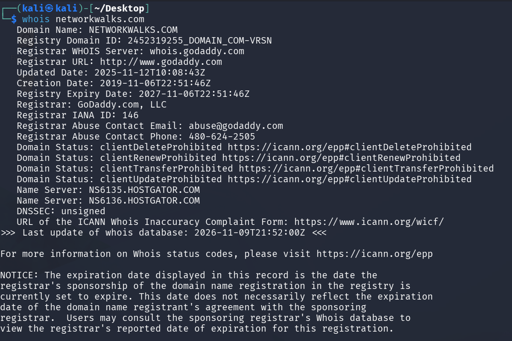

---

## 4.1.2 WhatWeb

Whatweb exposes the exact software and versions (here Wordpress 7.1.4 and Http server Apache.

### Screenshot

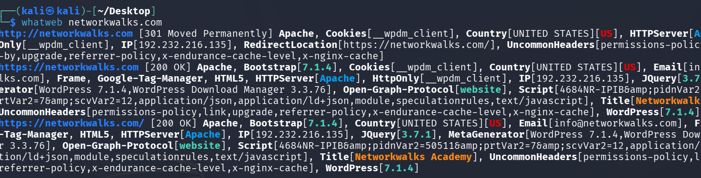

---

## 4.1.3 Nslookup

nslookup turns a domain name into its real IP address (192.232.216.135).

### Screenshot

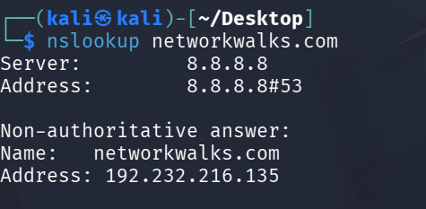

---

## 4.1.4 Curl-I

- HTTP Headers revealed server information
- WordPress REST API `/wp-json/` endpoint exposed

### Screenshot

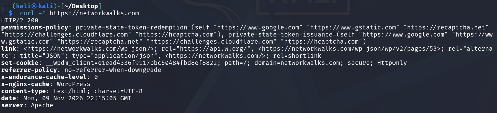

---

## 4.1.5 Wafw00f

**WAF Detected:** ModSecurity (SpiderLabs)

### Screenshot

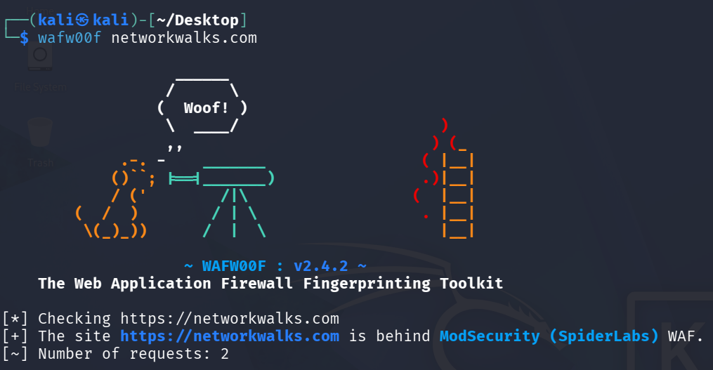

---

## 4.1.6 DNSRecon

- NS Records: HostGator nameservers
- MX Records: Mail servers
- TXT Records: SPF policy, Google verification
- SRV Records: cPanel autodiscover
- Bind Version: 9.16.23

### Screenshot

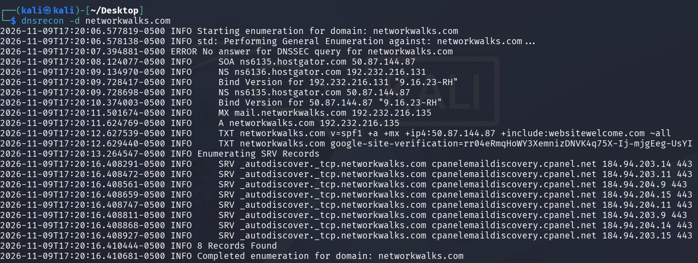

---

# 4.3 theHarvester Footprinting

theHarvester was used to collect information about `microsoft.com` from public sources.

## Task 1: Baidu Search

### Findings

| Type | Count |
|------|------:|
| Emails | 0 |
| Hosts | 0 |
| IPs | 0 |

### Screenshot

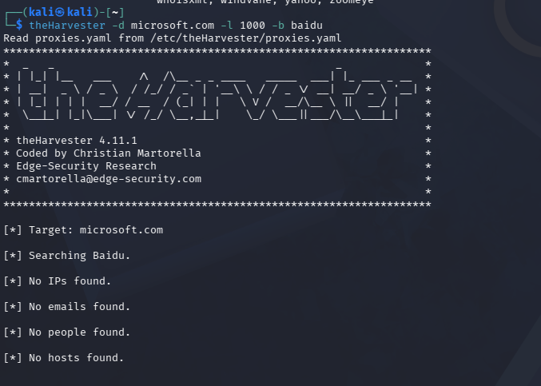

---

## Task 2: All Sources

### Findings

| Type | Count |
|------|------:|
| Email | 0 |
| Subdomain | 1422 |
| IPs | 38 |
| ASNs | 8 |
| Interesting URLs | 4 |

### Screenshot

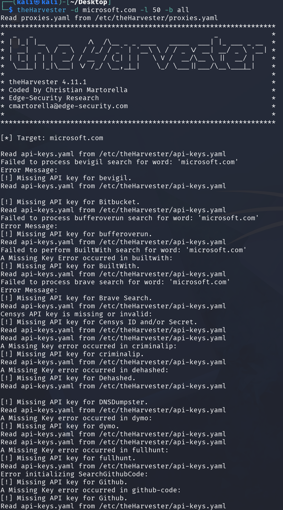
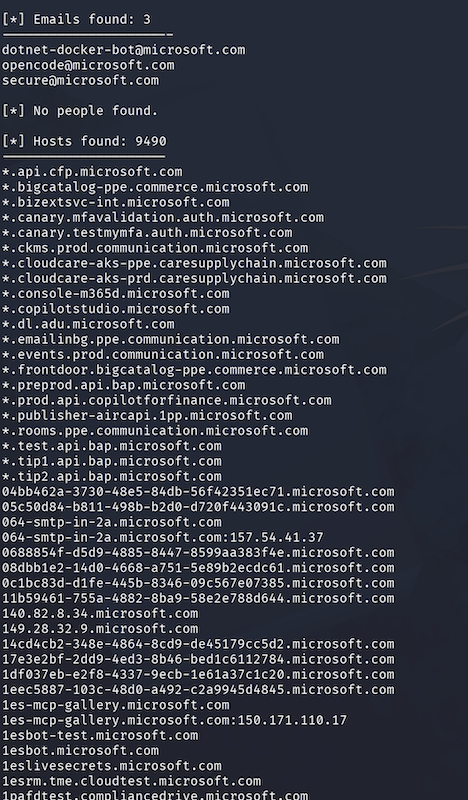
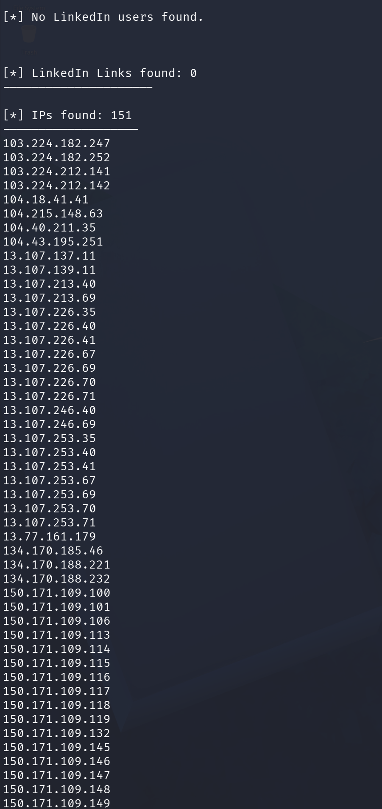
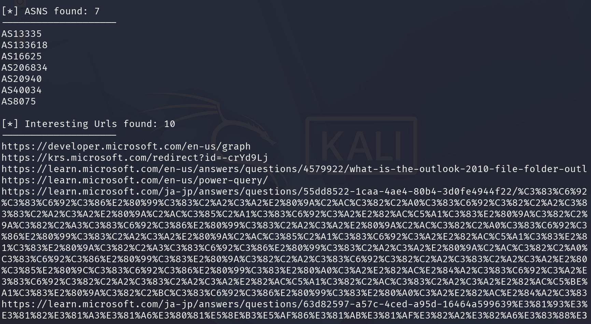

---

# 4.4 Zenmap Network Scanning

Zenmap was used to perform network discovery on my local network.

## Step 1: Find Local IP and Subnet

Mac terminal was used to identify the local network configuration.

---

## Step 2: Zenmap Ping Scan

### Target

`192.168.xxx.x/24`

### Profile

`Ping Scan`

### Screenshot

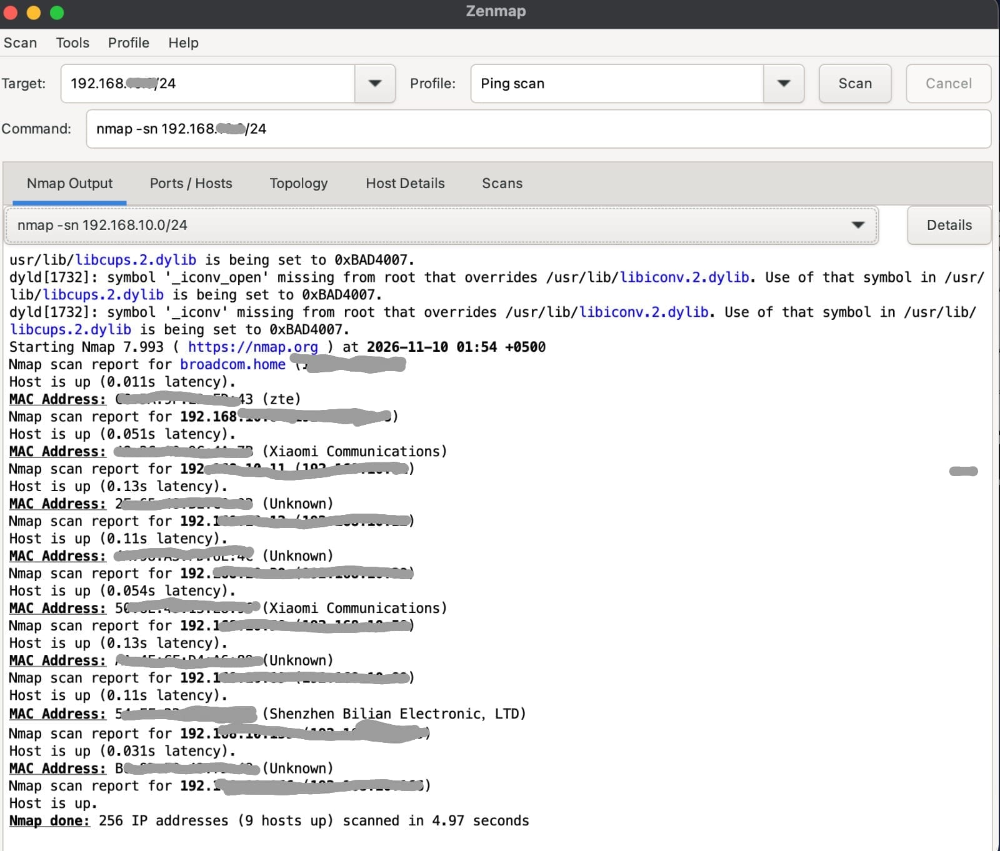

---

## Findings

| Detail | Value |
|--------|-------|
| Live hosts count | 9 |
| Total IPs scanned | 256 |
| Scan time | 4.97 |

---

## Step 3: MAC Addresses

Mac terminal was used to identify MAC addresses of devices on the local network.

---

# 5. Risk Analysis / Impact

Based on the information collected during the footprinting and network scanning activities, the following potential risks were identified.

| # | Risk / Finding | Evidence / Observation | Potential Impact | Risk Level |
|---|----------------|-----------------------|------------------|------------|
| 1 | Web technology information exposed | WhatWeb identified WordPress and WP Download Manager | Attackers may use exposed technology/version information to identify software requiring further security review | Medium |
| 2 | Server IP address identifiable | Nslookup resolved the domain to 192.232.216.135 | Provides information about the network location of the web service | Low |
| 3 | HTTP technical information exposed | Curl returned HTTP response headers and exposed `/wp-json/` | May assist technology fingerprinting and further enumeration | Low |
| 4 | WAF technology identifiable | Wafw00f identified ModSecurity (SpiderLabs) | Reveals information about the web application's security architecture | Low |
| 5 | DNS infrastructure information exposed | DNSRecon identified DNS, mail and service-related records | DNS information can help build a broader infrastructure profile | Medium |
| 6 | Multiple live hosts visible on local network | Zenmap identified nine live hosts in the example network | Unknown or unauthorized devices may potentially be present on a network | Medium |

> The risks above are observations from the footprinting and scanning exercises, not confirmed vulnerabilities. No exploitation or vulnerability validation was performed.

---

#  Author

**Saba Fatima**

LinkedIn: [https://www.linkedin.com/in/sabafatimamin/](https://www.linkedin.com/in/sabafatimamin/)

---
